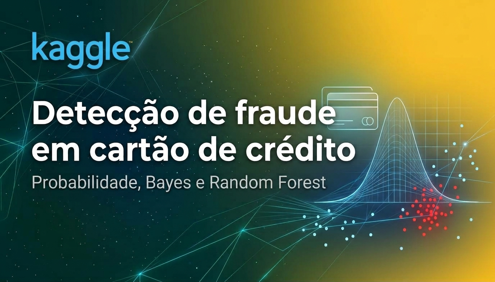

  

# **Detecção de fraude em cartão de crédito**

Projeto de análise e modelagem de fraude no dataset Credit Card Fraud Detection (MLG-ULB), com 284.807 transações e apenas 0,17% de fraudes.

- Notebook no Kaggle: https://www.kaggle.com/code/trinmat/creditcardfraud
- Dataset: https://www.kaggle.com/datasets/mlg-ulb/creditcardfraud

# **O que foi feito**

1. Análise exploratória: quantidade por classe, densidade dos valores, distribuição acumulada e transações ao longo do tempo.
2. Probabilidade condicional, probabilidade total e teorema de Bayes para calcular a probabilidade de fraude por faixa de valor.
3. Comparação de modelos: Naive Bayes, Regressão Logística e Random Forest.
4. Validação cruzada (5 divisões) e análise das variáveis mais importantes.

# **Resultados (conjunto de teste)**

| Modelo | PR-AUC | ROC-AUC |
|---|---|---|
| Só o valor da transação (Bayes por faixa) | 0,0046 | 0,745 |
| Naive Bayes | 0,081 | 0,956 |
| Regressão Logística | 0,698 | 0,969 |
| Random Forest | 0,818 | 0,937 |
| Chute (proporção de fraude) | 0,0017 | 0,5 |

Na validação cruzada (conjunto de treino), o PR-AUC médio foi 0,855 para o Random Forest e 0,775 para a Regressão Logística. As variáveis mais importantes foram V10, V14, V4, V12 e V17.

# **Como rodar**

1. Baixe o dataset no Kaggle (link acima) e guarde o `creditcard.csv` em uma pasta local. O arquivo não está neste repositório por ser grande.
2. Instale as dependências: `pip install -r requirements.txt`
3. No notebook, troque o caminho do `read_csv` (que aponta para `/kaggle/input/...`) pelo caminho do seu CSV.

# **Limitações**
- V1 a V28 são componentes anônimas (PCA), então não dá para interpretá-las.
- O dataset não identifica clientes, então a análise é do padrão global de fraude, e não do comportamento individual de cada cliente.
- O conjunto de teste tem poucas fraudes (~148), então os resultados têm incerteza.

# **Tecnologias e por que usei**

| Tecnologia | Por que usei |
|---|---|
| Python | Linguagem padrão em ciência de dados, com as bibliotecas de análise e de modelagem que o projeto precisava |
| NumPy | Cálculos numéricos: transformação logarítmica dos valores, faixas dos histogramas e densidades por classe |
| pandas | Carregar o dataset e manipular os dados em tabelas (separar classes, treino e teste, tabela de probabilidades) |
| Matplotlib | Gráficos de densidade, distribuição acumulada, curvas Precisão × Recall e ROC |
| scikit-learn | Divisão treino/teste, modelos (Naive Bayes, Regressão Logística e Random Forest), validação cruzada e métricas (PR-AUC e ROC-AUC) |
| Jupyter Notebook | Juntar código, gráficos e explicações no mesmo documento |
| Kaggle | Ambiente para rodar o notebook e acesso direto ao dataset |
- V1 a V28 são componentes anônimas (PCA), então não dá para interpretá-las.
- O dataset não identifica clientes, então a análise é do padrão global de fraude, e não do comportamento individual de cada cliente.
- O conjunto de teste tem poucas fraudes (~148), então os resultados têm incerteza.

# **Técnicas estatísticas utilizadas**
| Técnica | Onde foi usada |
|---|---|
| Histograma de densidade | Comparar como os valores e o horário das transações se distribuem em fraudes e em transações normais |
| Distribuição acumulada empírica, F(x) | Ver a fração de transações até cada valor e identificar valores muito repetidos nas fraudes |
| Transformação logarítmica, log(1 + x) | Tornar legível a distribuição dos valores, que tem cauda muito longa |
| Probabilidade a priori | Proporção de fraude no dataset (0,17%) |
| Verossimilhança | Densidade dos valores dentro de cada classe, P(valor \| classe) |
| Probabilidade total | Denominador do teorema de Bayes, combinando as duas classes ponderadas pelo priori |
| Teorema de Bayes (probabilidade a posteriori) | Probabilidade de fraude dado o valor da transação, calculada por faixa |
| Razão de verossimilhança | Quantas vezes uma faixa de valor é mais típica de fraude do que de transação normal |
| Naive Bayes | Somar a evidência de todas as variáveis, assumindo independência entre elas |
| Amostragem estratificada | Manter a proporção de fraude no treino, no teste e em cada divisão da validação cruzada |
| Validação cruzada estratificada (5 divisões) | Confirmar que a diferença entre os modelos não veio de uma única divisão dos dados |
| Balanceamento de classes por pesos (`class_weight="balanced"`) | Compensar o desbalanceamento (0,17% de fraudes) no treino dos modelos |
| Precisão, recall e matriz de confusão | Contar alertas, acertos, alertas falsos e fraudes que passaram em cada limite de decisão |
| PR-AUC e ROC-AUC | Comparar os modelos sem depender de um único limite de alerta |
| Importância de variáveis (Random Forest) | Descobrir quais variáveis mais ajudam a separar fraude de transação normal |

# **Possíveis melhorias**
- Escolher o limite de alerta com base no custo de cada tipo de erro (alerta falso e fraude que passa).
- Usar a variável de tempo no modelo, que ficou de fora desta versão.
- Testar outros modelos, como XGBoost e LightGBM, e ajustar os hiperparâmetros.
- Comparar outras formas de lidar com o desbalanceamento, como subamostragem e sobreamostragem (SMOTE).
- Repetir a validação cruzada várias vezes para estimar melhor a incerteza dos resultados.
- Avaliar se as probabilidades dos modelos são bem calibradas.
- Medir a distância entre as distribuições de fraude e normal com o teste de Kolmogorov-Smirnov.
- Refazer a análise por cliente (padrão individual de gasto diário e mensal), com um dataset que identifique clientes.
